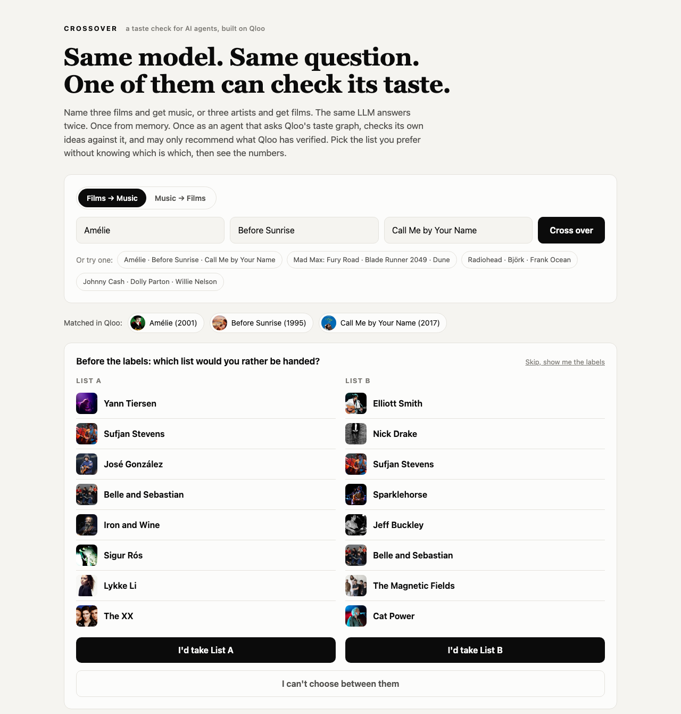
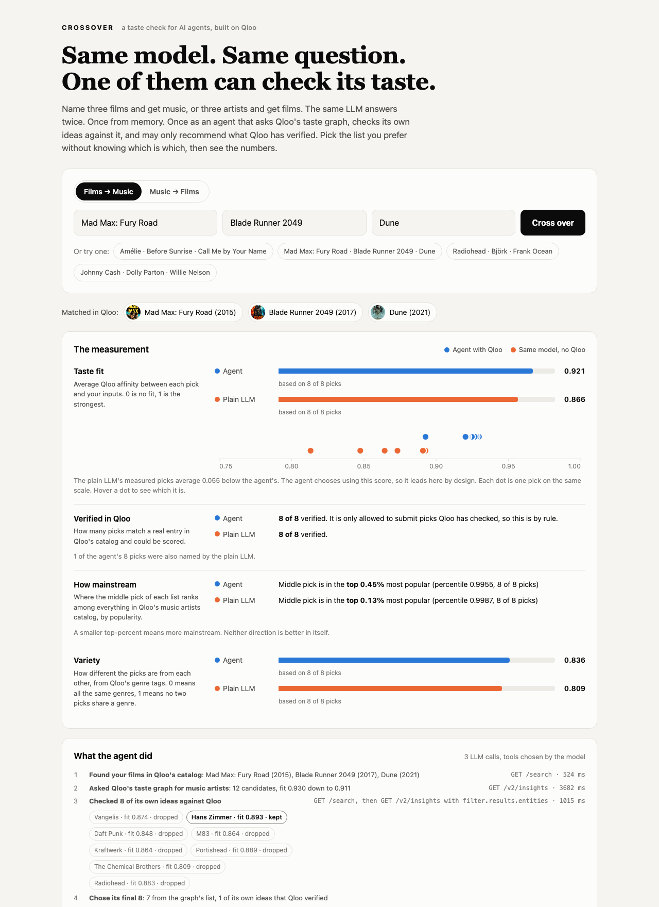

# Crossover

**A taste check for AI agents, built on Qloo.**

Same model. Same question. One of them can check its taste.

**Live demo: https://crossover-x9yy.onrender.com**

- [Try a comparison blind](https://crossover-x9yy.onrender.com/?from=movie&q=Am%C3%A9lie&q=Before+Sunrise&q=Call+Me+by+Your+Name): pick the list you prefer before the labels are shown
- [Go straight to the numbers](https://crossover-x9yy.onrender.com/?from=movie&q=Mad+Max%3A+Fury+Road&q=Blade+Runner+2049&q=Dune&labels=1)
- [The taste-check API](https://crossover-x9yy.onrender.com/docs#/default/api_check_api_check_post) for your own agent

Built for the [Qloo Agentic Hackathon](https://qloo.devpost.com/).

| Choose blind | See the measurement and what the agent did |
|---|---|
|  |  |

## The problem

An LLM will recommend things with total confidence, from memory. It has no way to know whether a pick fits the person in front of it, or whether the thing it named even exists. Teams building recommendation agents ship those guesses to users with nothing checking them.

Qloo's taste graph can do the checking. Crossover shows how, and measures the difference.

## What it does

You name three films and get music, or three artists and get films. The same LLM answers twice:

1. **As an agent with Qloo.** It has three tools and decides how to use them. It asks Qloo's taste graph what people with this taste love. It comes up with ideas of its own and has Qloo verify and score each one. Then it submits a final list, and it is only allowed to include picks Qloo has verified.
2. **From memory.** The same model, the same inputs, no tools.

Then the page does three things:

- **Blind vote.** You see both lists unlabelled and pick the one you would rather be handed. Only then are the labels shown.
- **Measurement.** Every pick on both sides is looked up in Qloo and scored against your inputs, on the same scale.
- **Trace.** You see what the agent did: which tools it called, which of its own ideas it checked, which it kept and which it dropped once it saw the score.

## The taste check, as a tool for your agent

The step that scores the plain LLM's list is a public endpoint. Any agent can call it before showing recommendations to a user.

```bash
curl -X POST https://crossover-x9yy.onrender.com/api/check \
  -H "Content-Type: application/json" \
  -d '{
    "input_domain": "movie",
    "output_domain": "artist",
    "likes": ["Dune", "Blade Runner 2049"],
    "candidates": [{"name": "Hans Zimmer"}, {"name": "Taylor Swift"}, {"name": "The Zxqv Flarnbuckles"}]
  }'
```

For each candidate you get back:

| Field | Meaning |
|---|---|
| `verified` | Whether Qloo's catalog has an entry with exactly this name (and, for films, this release year) that Qloo could score |
| `fit` | Qloo's affinity between the candidate and the person's likes, 0 to 1 |
| `why_not` | If not verified, the reason |

The response also includes `better_fits`, the taste graph's own top picks that were not in your list, and a `summary` with the same metrics the page shows. `input_domain` and `output_domain` are `"movie"` or `"artist"`. For films, add `"year"` to each candidate. The full schema is in the [interactive docs](https://crossover-x9yy.onrender.com/docs).

## How Qloo is used

| Step | Qloo call | Why |
|---|---|---|
| Find the user's inputs | `GET /search` with `types` | Turn names into entity ids |
| Ask the graph | `GET /v2/insights` with film entities as `signal.interests.entities` and `filter.type` set to artists, or the reverse | Cross-domain recommendation |
| See what drove each pick | `feature.explainability=true` | Per-input contribution |
| Verify a named pick | `GET /search`, exact-name match only | Qloo's search is fuzzy, so a hit alone proves nothing |
| Score named picks | `GET /v2/insights` with `filter.results.entities` | Affinity for specific entities against the same inputs |

The whole evaluation rests on one fact, confirmed against the live API before anything was built on it: **Qloo's affinity is an absolute score.** An entity gets the same value in a top-12 list as when it is scored by request. That is what makes it fair to put any agent's picks on the same axis as Qloo's own. Details are in [docs/qloo-api-notes.md](docs/qloo-api-notes.md).

## How the agent works

The code is in [app/agent.py](app/agent.py). The model is given three tools:

| Tool | What it does |
|---|---|
| `get_taste_graph_picks` | Qloo's top candidates for this taste, each with an id and a fit score |
| `check_my_ideas` | Verifies and scores the model's own ideas, and gives each verified one an id |
| `submit_picks` | The final answer, as a list of ids with a reason for each |

The model chooses which tools to call and in what order. One rule is enforced in code and not left to the prompt: **a final pick must be an id that a tool returned.** Anything else the model submits is thrown away, and the trace says how many were discarded. If the model comes up short, the list is topped up from the graph's picks, and the trace says that too.

If the LLM cannot be reached, the page shows Qloo's direct answer and labels it as such. It never shows invented results.

## The metrics

| Metric | What it is | How it is computed |
|---|---|---|
| **Taste fit** | How well the picks fit the inputs | Mean of Qloo's `query.affinity` (0 to 1) |
| **Verified in Qloo** | How much of a list could be checked | Count of picks matched to a catalog entry and scored |
| **How mainstream** | Whether a list leans on the obvious | Median of Qloo's `popularity` percentile, shown as "top X%" |
| **Variety** | How different the picks are from each other | Mean pairwise Jaccard distance between the picks' Qloo genre tags (0 to 1) |
| **Agreement** | How much the two lists share | Count of Qloo entity ids in both lists |
| **Blind preference** | Which list people choose without labels | A count of votes |

The arithmetic is in [app/metrics.py](app/metrics.py). Each function is tested against answers worked out by hand in [tests/test_metrics.py](tests/test_metrics.py).

### The rules

- **Nothing is estimated.** If a field is missing, that pick is left out of that metric, and the page says how many picks the number is based on.
- **A pick counts only on a confident match.** The normalised name must be identical, and for films the release year must agree to within one year. Otherwise it is shown as "not measured" with the reason. Without the year check, the 2002 *Solaris* would be scored as the 1972 one.
- **Unmeasured is not zero.** A pick Qloo cannot score is left out of the average. It does not drag it down.
- **The same fields for both sides.** Qloo reports slightly different popularity for one entity in `/search` and `/v2/insights`, so every number comes from insights responses.
- **The same model for both sides.** The page shows the model name on each side. If rate limits forced one side onto a fallback model, the names will differ and the result should be read with that in mind.

### What the numbers do and do not prove

- **The agent leads on taste fit by design.** Taste fit is Qloo's own score and the agent chooses using it. That row shows how far an unaided LLM lands from what the graph supports. It is not an independent verdict.
- **The agent is 8 of 8 verified by rule,** because it may only submit verified picks.
- **The blind vote is the independent evidence.** It is the one measure here that neither Qloo nor an LLM controls. The tally is kept in memory and written to the server log, so the on-page count restarts when the server is redeployed.
- **The baseline is an open-weight model on a free tier.** The live demo uses `openai/gpt-oss-120b` on Groq for both sides. A top commercial model may guess better from memory. The design holds either way, because both sides always use the same model.
- **Artists with the same name.** There is no release year to check for an artist, so when several share an exact name the most popular one in Qloo is used.

### Why only films and music

Travel, books and restaurants were tested as output domains and left out. Qloo's API accepts those pairings, but the results did not hold up: three European romance films returned Beijing, Tianjin and Wuhan as travel destinations, which looks like where the films' fans live, not where they would want to go. A check built on that score would have "proved" Qloo better on results a person would find worse. Films and music, in both directions, returned specific and convincing results for every taste profile tried. The full table is in [docs/qloo-api-notes.md](docs/qloo-api-notes.md).

## Run it yourself

You need Python 3.12 or newer, a Qloo hackathon API key, and a key for an LLM (a free Groq key works).

```bash
git clone https://github.com/anamankev/crossover.git
cd crossover

python3 -m venv .venv
source .venv/bin/activate          # on Windows: .venv\Scripts\activate
pip install -r requirements-dev.txt

cp .env.example .env               # then open .env and paste your keys
uvicorn app.main:app --reload
```

Open http://localhost:8000.

| Setting | Needed? | What it is |
|---|---|---|
| `QLOO_API_KEY` | yes | Your Qloo hackathon key |
| `QLOO_API_URL` | no | Defaults to `https://hackathon.api.qloo.com` |
| `LLM_API_KEY` | for the agent and the baseline | A free key from [console.groq.com](https://console.groq.com) works with the defaults. Without it the page shows Qloo's direct answer only and says so. `/api/check` needs no LLM. |
| `LLM_BASE_URL` | no | Any OpenAI-compatible API with tool calling. Defaults to Groq. |
| `LLM_MODELS` | no | Comma-separated, tried in order. Defaults to `openai/gpt-oss-120b,qwen/qwen3.8-27b,openai/gpt-oss-20b` |

### Run the tests

```bash
python -m pytest
```

123 tests. They use invented data in the same shape as Qloo's and a scripted stand-in for the LLM, so they need no keys and make no network calls.

## How the code is laid out

| File | What it does |
|---|---|
| [app/qloo.py](app/qloo.py) | Qloo client: search, recommend, score. Rate limiting, retries, caching. |
| [app/agent.py](app/agent.py) | The tool-using agent and the rule that it may only submit verified picks |
| [app/compare.py](app/compare.py) | The taste check: matching named picks to Qloo entities and scoring them |
| [app/llm.py](app/llm.py) | LLM client with model fallback, and the plain-LLM baseline prompt |
| [app/metrics.py](app/metrics.py) | The evaluation |
| [app/main.py](app/main.py) | Web endpoints, per-visitor rate limit, blind votes, keepalive |
| [static/](static/) | The page: plain HTML, CSS and JavaScript, no build step |
| [tests/](tests/) | Unit tests for all of the above |
| [docs/qloo-api-notes.md](docs/qloo-api-notes.md) | What was confirmed against the live Qloo API |
| [BUILD_LOG.md](BUILD_LOG.md) | How this was built, in plain language |

## Deploying

[](https://render.com/deploy?repo=https://github.com/anamankev/crossover)

The repo includes a [render.yaml](render.yaml) for Render's free plan. Click the button, sign in to Render, then enter `QLOO_API_KEY`, `LLM_API_KEY` and `REPO_URL` (this repo's address) when asked. Keys are never stored in the repo.

Render's free plan sleeps after 15 idle minutes. The app pings its own `/healthz` every 10 minutes to stay awake, a scheduled GitHub Action does the same from outside, and the page shows a "waking the server" message if a first request is slow. `/healthz` never calls Qloo or the LLM, so staying awake costs no quota.

## Limits

- Qloo's hackathon key allows 5 requests a second and 10,000 a month. A fresh comparison uses about 20. Responses are cached in memory for a day.
- Groq's free tier allows 1,000 requests a day and 8,000 tokens a minute per model. A fresh comparison uses about four LLM calls. When one model is rate limited the next is tried.
- Each visitor is limited to 20 requests per 10 minutes on each endpoint.
- Agent and LLM answers are cached for a day, so the same inputs show the same lists until the cache expires.

## License

[MIT](LICENSE)
